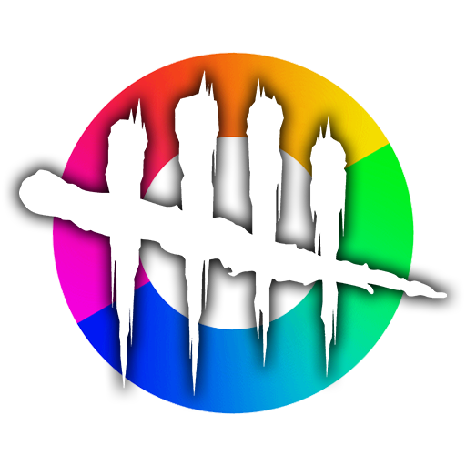

<div align="center">



# DBD Reshade

**The best ReShade presets for Dead by Daylight, installed in one click.**

Pick a preset, try it on real map screenshots without opening the game, install it and play.

[](https://github.com/Joolace/dbd-reshade/releases/latest)
[](https://discord.gg/mC7Eabu3QW)
[](LICENSE)

[](https://app.codacy.com/gh/Joolace/dbd-reshade/dashboard)
[](https://www.codefactor.io/repository/github/joolace/dbd-reshade)
[](https://makeapullrequest.com)
[](https://github.com/Joolace/dbd-reshade/issues?q=is%3Aissue+is%3Aopen+label%3Abug)

**English** · Interface also in Italiano, Español, Français, Deutsch, Português, Русский, 简体中文, 日本語, 한국어

</div>

<!-- SCREENSHOT: main window, Install Preset page with a preset selected (dark theme) -->


---

## Contents

- [What's new in 2.0](#whats-new-in-20)
- [Download and install](#download-and-install)
- [Quick start](#quick-start)
- [Features](#features)
- [Supported versions of the game](#supported-versions-of-the-game)
- [Keyboard shortcuts](#keyboard-shortcuts)
- [FAQ and troubleshooting](#faq-and-troubleshooting)
- [Help translate](#help-translate)
- [Submit a preset](#submit-a-preset)
- [Credits](#credits)
- [Disclaimer](#disclaimer)
- [For developers](#for-developers)
- [License](#license)
- [Contact](#contact)

---

## What's new in 2.0

DBD Reshade has been **rebuilt from scratch** as a real Windows app. The old PowerShell script is still on the
[`main`](https://github.com/Joolace/dbd-reshade/tree/main) branch.

- ✨ **One-click install**: finds the game, installs the latest ReShade, downloads the effects the presets need and sets everything up
- 🗺️ **Try on maps**: preview any preset on real DBD map screenshots without launching the game (D3Daylight is now built in)
- 🎨 **Preset Editor**: create your own presets with the full ReShade menu, live on map screenshots
- 🎮 **Steam, Epic Games and Xbox app / PC Game Pass** support, plus a **Launch game** button
- 🔄 **Automatic updates** for the app (one click) and for presets (no app update needed)
- 🌍 **10 languages**, dark / light theme, a modern interface with its own title bar
- 📦 **Installer or portable**, no .NET or other runtime to install

---

## Download and install

Go to the **[latest release](https://github.com/Joolace/dbd-reshade/releases/latest)** and download **one** of these:

| File | For |
|---|---|
| **`DBDReshade-Setup.exe`** | **Recommended.** Installs the app with a Start menu entry, optional desktop icon and an uninstaller. |
| `DBDReshade.exe` | Portable: a single file, nothing to install. Put it in any folder and run it. |

Both update themselves with one click when a new version is out.

**Requirements**
- Windows 10 or 11, 64-bit
- Administrator rights: the game usually sits in `Program Files`, and ReShade has to be installed next to the game's exe
- An internet connection for ReShade, effects, previews and map screenshots (installed presets keep working offline)

> **Windows protected your PC?** SmartScreen warns about new apps that few people have downloaded yet.
> Click **More info → Run anyway**. Only download the app from this repository's
> [Releases](https://github.com/Joolace/dbd-reshade/releases) page.

---

## Quick start

1. **Close Dead by Daylight** if it's running.
2. Open **DBD Reshade**. The game is found automatically (otherwise click the folder icon in the **Game** box and pick it).
3. Choose a preset from the list. Use the search box, the preview and the **Source** link to find the one you like.
4. *(Optional)* Click **Try on maps** to see it on real map screenshots first.
5. Click **Install preset**. The app installs ReShade (if needed) and the effects, then activates the preset.
6. Click **Yes** to launch the game, or use **Launch game** later. In game, press **Home** to open the ReShade menu.

To switch preset, select another one and click **Install preset** again. Every preset of the library also
works from ReShade's own menu in game.

<!-- SCREENSHOT: the confirmation dialog after installing ("Preset installed! … Launch Dead by Daylight now?") -->


---

## Features

### Install Preset

<!-- SCREENSHOT: Install Preset page, highlighting the preset list, preview, Game box and the three buttons -->


- **139+ presets** with description, author link and a large preview (click it or press **Space** for full screen)
- **Finds the game** on Steam, Epic Games and the Xbox app, or pick the folder by hand
- **Installs ReShade** automatically, always the latest version from [reshade.me](https://reshade.me)
- **Keeps ReShade up to date**: if a newer version is out, the app offers to update it (settings, presets and effects are kept)
- **Downloads the effects** the presets need, from the official ReShade effect packages
- **Shows** the installed ReShade version and the preset that's active in game
- **Custom preset folder**: save presets in the game folder (recommended) or anywhere you like
- **Launch game**: starts Dead by Daylight through Steam, Epic or Xbox, opening them first if they're closed
- **Safe**: won't install while the game is running, and won't overwrite another mod's `dxgi.dll`

### Try on maps

<!-- SCREENSHOT: the map picker window (list of realms + "My screenshots") -->


<!-- SCREENSHOT: the preview window showing a preset on a map, with the red "F1 – Show keys" badge visible -->


- See any preset on **real screenshots of every realm**, with the real ReShade, **without starting the game**
- Screenshots are downloaded one realm at a time, only when you open it
- **Use your own screenshots**: add them under *My screenshots*
- Press **F1** to see all the keys (always shown top right)
- The preview never changes your presets: it works on a temporary copy

### Preset Editor

<!-- SCREENSHOT: Preset Editor page (steps 1–4) -->


<!-- SCREENSHOT: the editor window with the ReShade menu open on a map -->


Create your own preset, live on map screenshots:

1. **Name** your preset and choose where to start: an empty preset or a copy of any preset in the library
2. **Pick a realm** (or your own screenshots)
3. **Edit**: press **Home** to open ReShade, enable effects and move their sliders. Changes are saved automatically.
   Press **Print Screen** to take the screenshot that will be the preset's preview.
4. **Save** it to your library with a description and an optional source link

Unfinished presets are kept as drafts: type the same name to continue later.

### Preset Manager

<!-- SCREENSHOT: Preset Manager page -->


- **Add your own presets** (`.ini`) with description, source link and screenshot
- **Delete presets** you don't use. Deleted official presets don't come back with updates, and can be **restored** at any time with the button at the bottom of the list.
- If your preset has the same name as an official one, you choose: keep both, or replace the official one

### Copy Presets

<!-- SCREENSHOT: Copy Presets page -->


Copy any selection of presets (or all of them) to a folder, for example to share them or to use them with another game.

### Settings

<!-- SCREENSHOT: Settings page (language, theme, storage) -->


- **Language**: 10 languages, switch instantly. Translations are updated automatically.
- **Theme**: dark, light, or follow Windows
- **Storage**: see how much space previews, map screenshots, logs and temporary files use, and free it with one click.
  Your presets, drafts and screenshots are never deleted.
- **Help translate** and **Report a bug** links

### And also

- **Automatic preset updates**: new and updated presets arrive at startup, without updating the app
- **One-click app updates**: when a new version is out, a banner appears in the sidebar. Click **Update now**.
- **Report a bug**: opens our Discord and the logs folder, so you can attach today's log
- **Light on disk**: previews (about 1 GB in total) and map screenshots are downloaded only when you look at them

<!-- SCREENSHOT (optional): light theme -->


---

## Supported versions of the game

| Store | Detected automatically | Where ReShade goes |
|---|---|---|
| **Steam** | ✅ | `DeadByDaylight\Binaries\Win64` |
| **Epic Games** | ✅ | `DeadByDaylight\Binaries\EGS` |
| **Xbox app / PC Game Pass** | ✅ (default and custom Xbox folders) | `Content`, next to `gamelaunchhelper.exe` |

For the Xbox version ReShade goes next to `gamelaunchhelper.exe`, because the Xbox app protects the game's
real exe. This is the method recommended for Game Pass games. Xbox support is new: if something doesn't work,
please tell us on Discord.

---

## Keyboard shortcuts

**Install Preset**

| Key | Action |
|---|---|
| Space | Show the preview full screen |

**Map preview and Preset Editor**

| Key | Action |
|---|---|
| ← → | Previous / next screenshot |
| Home | Open / close ReShade |
| Print Screen | Take a screenshot (in the editor it becomes the preset's preview) |
| F11 | Full screen |
| F1 | Show / hide the keys |
| ESC | Close |

**In game**: **Home** opens the ReShade menu, where you can also switch between the installed presets.

---

## FAQ and troubleshooting

<details>
<summary><b>Is it bannable?</b></summary>

ReShade is a post-processing injector that many Dead by Daylight players and streamers use. However, there's
no guarantee: see the [Disclaimer](#disclaimer). Use it at your own risk.
</details>

<details>
<summary><b>The preset is installed but nothing changes in game</b></summary>

1. Make sure the game was **closed** while installing.
2. In game press **Home**: if the ReShade menu doesn't open, ReShade isn't loaded. Click **Install preset** again (the app reinstalls ReShade if it's missing).
3. If the menu opens but the effects show errors, click **Install preset** again: missing effects are downloaded again.
4. Still not working? Use **Report a bug** and attach the app's log, plus `ReShade.log`, which is in the same folder as ReShade (see [Supported versions of the game](#supported-versions-of-the-game)).
</details>

<details>
<summary><b>"These effects aren't in ReShade's official effect packages"</b></summary>

A few older presets list effects whose authors have removed them. The preset still works, just without that
effect. Effects that have been retired and don't change the image (for example `SuperDepth3D_VR+`, `computeGravity`) aren't reported.
</details>

<details>
<summary><b>"The game folder already has a dxgi.dll that belongs to another program or mod"</b></summary>

Another tool is using the same file ReShade needs. The app stops instead of breaking that tool. Remove or rename
that `dxgi.dll` (or uninstall the other tool), then install again.
</details>

<details>
<summary><b>Windows SmartScreen or my antivirus warns about the app</b></summary>

New apps are flagged until enough people have downloaded them, and tools that install ReShade (which hooks into
games) are sometimes reported as false positives. Download only from this repository's
[Releases](https://github.com/Joolace/dbd-reshade/releases) page. The source code is all here.
</details>

<details>
<summary><b>Why does the app ask for administrator rights?</b></summary>

The game is usually installed in `Program Files`, and ReShade, its settings and its effects have to go next to the
game's exe. Steam, Epic and the game itself are still started normally, without administrator rights.
</details>

<details>
<summary><b>How do I remove ReShade from the game?</b></summary>

Run the official ReShade installer from [reshade.me](https://reshade.me), select Dead by Daylight and choose
**Uninstall**. Uninstalling DBD Reshade doesn't touch the game.
</details>

<details>
<summary><b>Where does the app keep its files?</b></summary>

Everything is in `%LOCALAPPDATA%\DBDReshade` (presets, previews, map screenshots, settings, logs). The folder icon
next to the log opens it. When you uninstall, you can choose whether to keep it.
</details>

---

## Help translate

The interface is translated into 10 languages, and **anyone can improve a translation or add a new language**.
No coding needed, just a JSON file: see the [translation guide](./translations/README.md).
Translations reach every user automatically, without an app update.

---

## Submit a preset

Made a great preset? Share it on our [Discord](https://discord.gg/mC7Eabu3QW) or open a pull request with the
`.ini` in [`Presets/`](./Presets), a preview image in [`media/preview-preset/`](./media/preview-preset) and an entry
in [`media/presets.json`](./media/presets.json). New presets reach every user automatically.

---

## Credits

**Presets**: a special thanks to their creators.

- **STX**: [steaxss](https://github.com/steaxss/STEAXS-FILTER-PACK)
- **April**: [April](https://www.youtube.com/watch?v=2_YQ_rWiKFE)
- **Aroz**: [Aroz](https://www.youtube.com/watch?v=4TArEDvT_ec&t=30s)
- **Azef**: [Azef](https://www.youtube.com/watch?v=FUelIy0sGOk)
- **Faelayis**: [Faelayis](https://github.com/Faelayis/dbd-reshade)
- **Henz**: [Henz](https://discord.com/invite/HxjbEKuvZY)
- **KnightLight**: [KnightLight](https://www.twitch.tv/knightlight)
- **Koda**: [Koda](https://discord.com/invite/bNvWEde5Vr)
- **MomoSeventh**: [MomoSeventh](https://www.twitch.tv/momoseventh/)
- **Trolling Prophets**: [Trolling Prophets](https://discord.com/invite/bNvWEde5Vr)
- **NUGGETZ**: [NUGGETZ](https://www.youtube.com/watch?v=Qs28LJTro70)

See each preset in [`Presets/`](./Presets) for details.

**ReShade** by [crosire](https://github.com/crosire/reshade). **Effects** are downloaded from their authors'
repositories through ReShade's official package list, including SweetFX (CeeJay.dk), prod80, AstrayFX and Depth3D
(BlueSkyDefender), Insane-Shaders (Lord of Lunacy), fubax-shaders, CobraFX (SirCobra), qUINT (Marty McFly) and more.

---

## Disclaimer

- **Responsibility**: I do not assume any responsibility for bans or other consequences resulting from the use of this tool. Use it at your own risk.
- **False positives**: some antivirus programs may flag the app. Download it only from the official repository.
- DBD Reshade is a fan project, not affiliated with or endorsed by Behaviour Interactive or ReShade.
  *Dead by Daylight* is a trademark of Behaviour Interactive Inc.

---

## For developers

The app is written in C# with WPF and .NET 8. Source, build instructions, project layout and the release process
are in **[`app/README.md`](./app/README.md)**. In short:

```powershell
cd app
dotnet publish src\DBDReshade\DBDReshade.csproj -c Release -o publish
```

- [`app/`](./app): the Windows app (Visual Studio solution `app/DBDReshade.sln`)
- [`Presets/`](./Presets), [`media/`](./media): presets, previews and their descriptions, synced by the app
- [`Maps/`](./Maps): map screenshots for *Try on maps*, one folder per realm
- [`translations/`](./translations): interface translations
- [`tools/validate.py`](./tools/validate.py): checks presets, translations and maps (also run on every pull request)

Contributions are welcome: open an issue or a pull request.

---

## License

GNU General Public License v3.0. See [LICENSE](LICENSE).

## Contact

- **Discord**: [join the community](https://discord.gg/mC7Eabu3QW)
- **Twitch**: [Joolace_](https://twitch.tv/joolace_)
- **Instagram**: [joolace](https://www.instagram.com/joolace)
- **GitHub**: [Joolace](https://github.com/Joolace)
